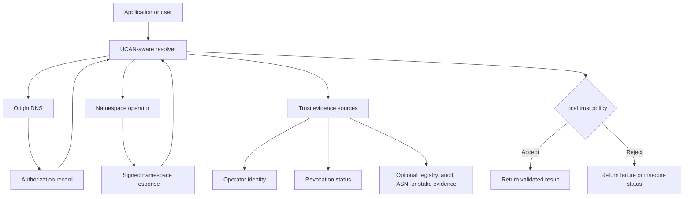

# UCAN Architecture Diagram



## Trust chain

```text
Origin domain control
        ↓
Signed namespace authorization
        ↓
Designated namespace operator
        ↓
Independent operator trust evidence
        ↓
Resolver-local trust policy
        ↓
Validated response
```
